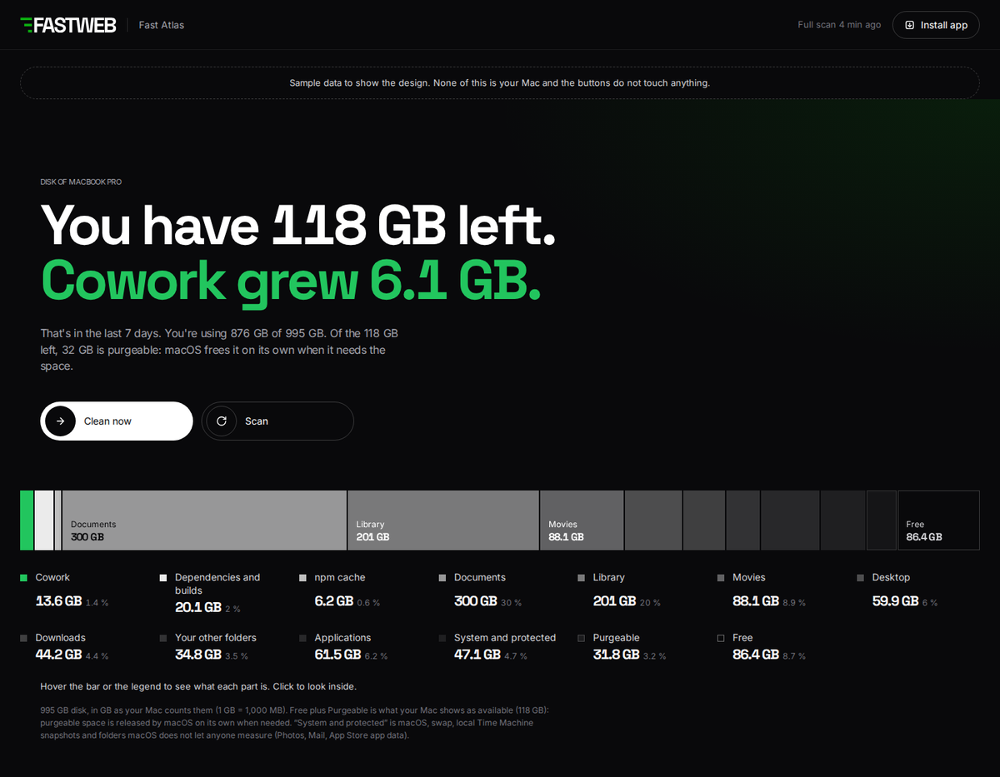

# Fast Atlas

A local map of your Mac: what takes up disk and memory, what each thing is, and what is safe to remove. Made for people who code with AI.

A [Fast Web](https://fast-web.es) Labs app, made in Barcelona.



## Why

Coding with AI leaves things behind that you never see: a Cowork virtual disk that keeps growing ([reported here](https://github.com/anthropics/claude-code/issues/65577)), `node_modules` and `.next` folders in every project, the npm cache, local AI models, app caches. Fast Atlas puts all of it on one screen, explains each folder in plain words and lets you clean what rebuilds itself.

## Install

Requires macOS and Node.js 18.15 or newer.

```
npx github:Fast-web-es/fast-atlas
```

It installs into `~/.fast-atlas`, starts with your Mac (launchd, low priority) and opens `http://localhost:4848`. Run the same command again to update.

## What you see

- **The disk at a glance**: one bar with everything, from Cowork to the purgeable space macOS counts as free.
- **What grows on its own**: Cowork, npm cache, dependencies, Next.js builds, Claude Code, app caches, Downloads, Trash, Docker and local AI models, each with what it is and what happens if you clean it.
- **Your projects**: dependencies and builds per project, when you last touched it, its package manager and the exact command to get everything back.
- **Large files**: single files over 250 MB, with what they are.
- **Inside**: browse any folder with a one-line explanation of each item.
- **History and memory**: free space over 30 days, what grew the most, and which apps use the most memory.
- **Install as an app**: Safari, File > Add to Dock. Chrome, the install icon in the address bar.

## Safety

Fast Atlas is built so that using it cannot cause a disaster. These rules are enforced in the code and checked by [automated tests](test/safety.test.mjs) on every change, on macOS and Linux.

1. **Nothing is deleted unless you click and confirm.** Automatic cleanup is off by default. If you turn it on, it only empties the npm cache and the `.next` builds of projects you have not touched in 60 days.
2. **Your files only go to the Trash**, so you can put them back. Direct deletion is reserved for what rebuilds itself: `node_modules`, `.next` and the npm cache, which is emptied with npm's own command.
3. **It stays inside your home folder**, never at its top level, never in `~/Library` except app caches, never in settings folders like `~/.ssh` or `~/.config`, never inside apps or photo libraries.
4. **Projects lock themselves** when Claude, Claude Code, Cursor or Windsurf use them as MCP servers, or a launchd or cron task runs them. You can lock any project by hand.
5. **It skips anything with a program running inside**, like a dev server or Claude Code.
6. **It never follows links.** Workspace and pnpm links inside `node_modules` are removed, never what they point to.
7. **Every delete passes a last safety check** that refuses paths outside your home folder or too close to it.
8. **The Cowork disk is never deleted directly.** It is moved to a backup you can restore, and removed only when you say so.
9. **No sudo, no password, no network.** It listens only on your Mac (127.0.0.1), sends nothing to the internet and rejects requests from other websites.
10. **No secrets stored.** It reads your AI tools' config files only to learn which folders they use, and keeps only those folder paths.

Run the tests yourself with `npm test`.

## Permissions you may see

- **"node" wants to access Desktop, Documents or Downloads**: allow it, or those folders are not measured.
- **"Background items added"**: that is Fast Atlas starting with your Mac.
- **"node" wants to control Finder**: only the first time you empty the Trash from Fast Atlas, or move something to the Trash on macOS 14 or earlier. On macOS 15 or later it uses the system's own trash command.

## Uninstall

```
npx github:Fast-web-es/fast-atlas uninstall
```

It removes `~/.fast-atlas` and its launch agent, and nothing else. It refuses while a Cowork backup is kept, so you never lose it by accident. If you installed it as an app, drag Fast Atlas from Applications to the Trash.

## Support

Fast Atlas is free and open source. If it helped you, you can [sponsor Fast Web Labs on GitHub](https://github.com/sponsors/Fast-web-es).

## License

MIT. Made by [Fast Web](https://fast-web.es).
